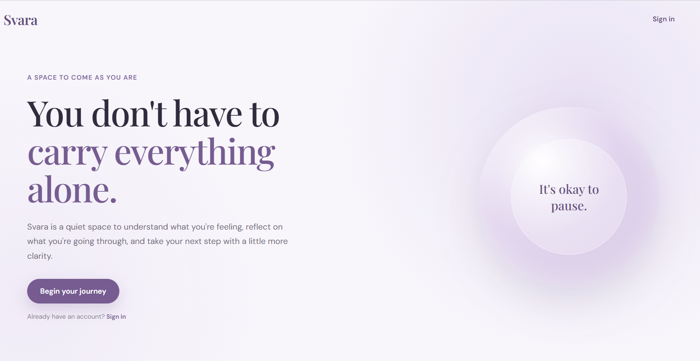
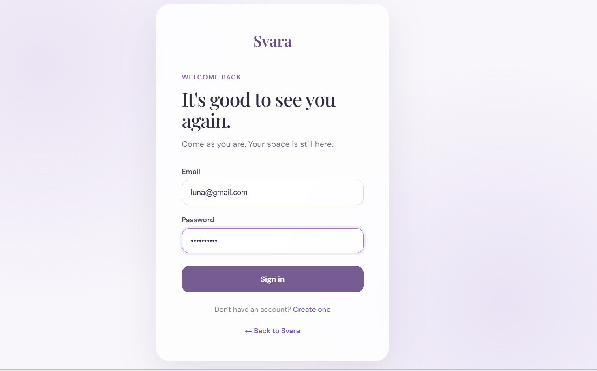
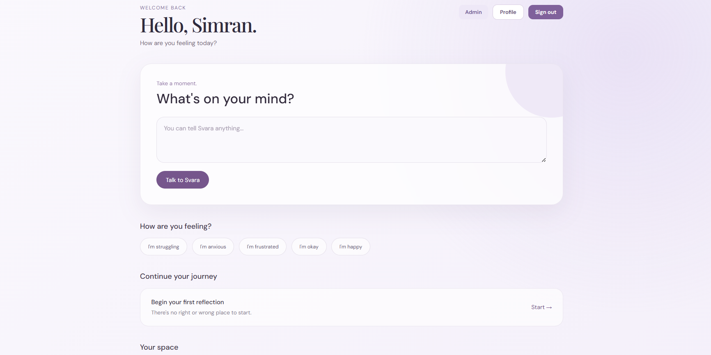
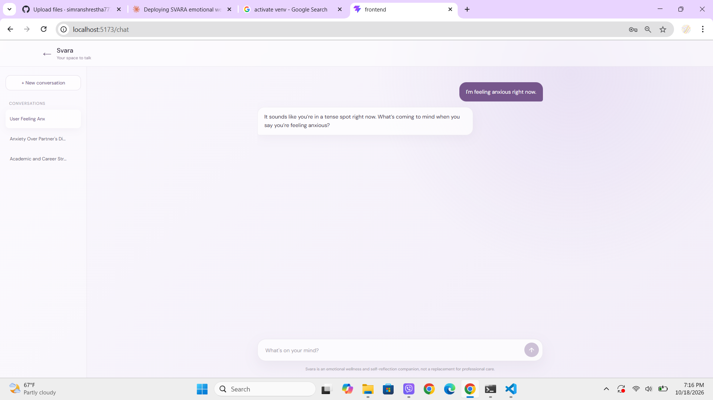
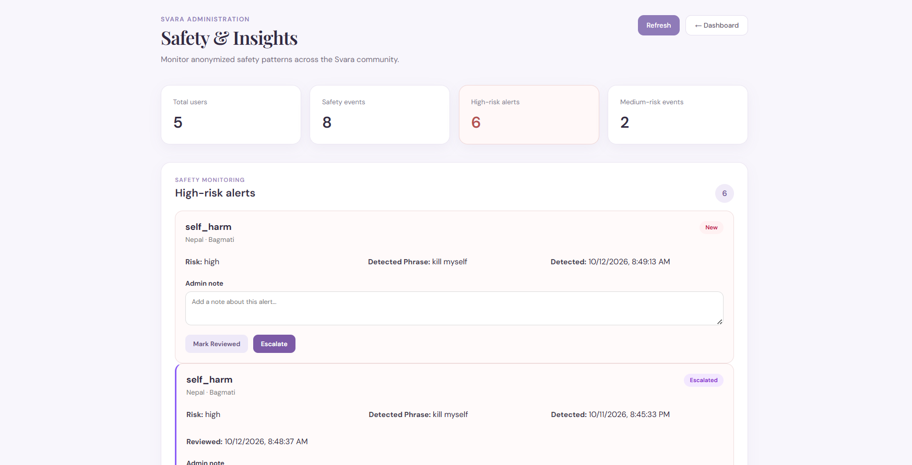

# Svara

**Svara** is an AI-assisted emotional wellbeing and self-reflection web app. It gives people a calm, private space to talk through their feelings, journal, reflect, and build healthy daily habits, with built-in safety features for moments of distress.

> **Status: early prototype.** Svara is a work in progress and is **not a crisis service, a medical device, or a replacement for professional care.**

---

## Features

**For users**
- **AI companion chat** with saved conversations and auto-generated titles
- **Journaling** for private daily entries
- **Guided reflection** prompts
- **Mood check-ins** and **personalized insights**
- **Calm** exercises and **daily affirmations**
- **Profile** with country and region

**Safety**
- Detection of high-risk and medium-risk phrases in chat messages
- **Country-based crisis helplines** shown when a message signals self-harm risk
- Safety events logged with risk level, category, country and region

**For admins**
- **Admin dashboard** with analytics overview
- Review of safety alerts, with status updates (new, reviewed, escalated) and admin notes

---

## Tech stack

| Layer | Technology |
|---|---|
| Frontend | React, Vite, React Router |
| Backend | FastAPI, SQLAlchemy, Pydantic |
| Auth | JWT (python-jose), bcrypt (passlib) |
| Database | PostgreSQL (SQLite works for local development) |
| AI | Groq API |
| Hosting (demo) | Vercel (frontend), Render (backend), Neon (database) |

---

## Project structure

```
svara/
├── frontend/                 # React + Vite app
│   ├── src/
│   │   ├── pages/            # Landing, Login, Register, Dashboard, Chat,
│   │   │                     # Reflection, Journal, Calm, Affirmations,
│   │   │                     # Insights, Profile, AdminDashboard
│   │   └── ...
│   ├── vercel.json           # SPA routing for Vercel
│   └── .env.example
└── backend/                  # FastAPI app
    ├── app/
    │   ├── main.py           # App setup, CORS, routers
    │   ├── models.py         # Database models
    │   ├── schemas.py        # Request/response schemas
    │   ├── auth.py           # JWT login and password hashing
    │   ├── database.py       # DB connection
    │   ├── ai_service.py     # Groq chat and title generation
    │   ├── safety_service.py # Risk phrase detection
    │   ├── helpline_service.py # Country-based crisis resources
    │   └── routers/          # ai, conversations, reflections, checkins,
    │                         # journal, insights, admin
    ├── make_admin.py         # Promote a user to admin
    ├── requirements.txt
    └── .env.example
```
## Screenshots

**Landing Page**


**LogIn Page**


**User Dasboard Page**


**Chat Page**


**Admin Page**


